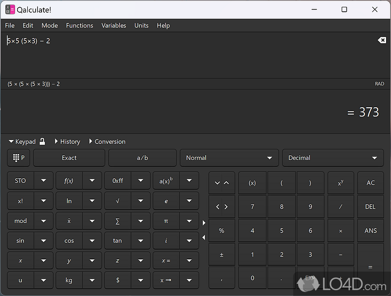
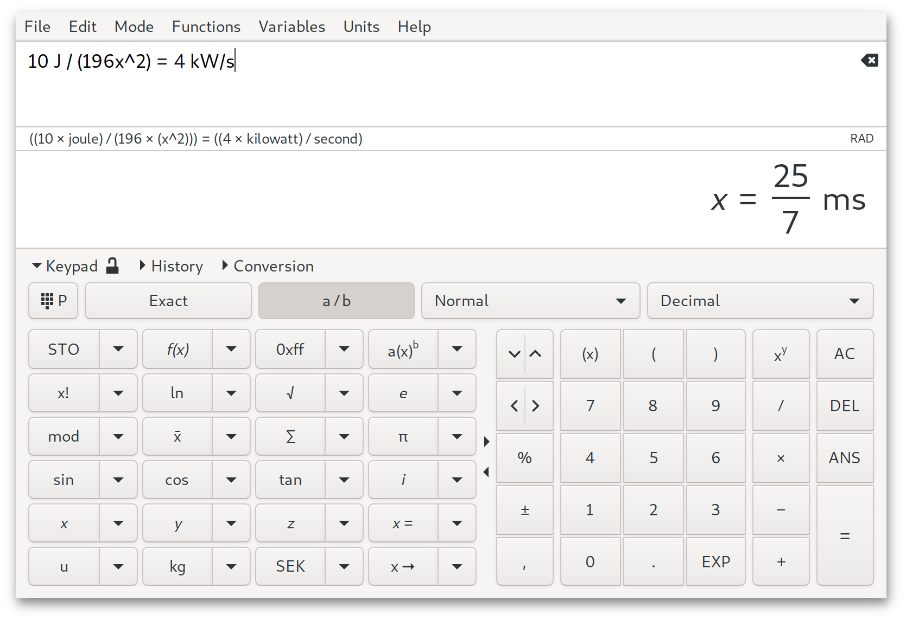

# Qalculate! Keeps Units and Algebra in Your Calculations

A distance divided by a duration should remain a speed throughout the calculation. Qalculate! combines unit-aware arithmetic, symbolic expressions, and configurable numerical output, with qalc for terminal work and Qt or GTK interfaces for desktop use.

## Write the Expression You Intend to Evaluate

For qalculate command line work, pass the complete expression as one quoted shell argument. This preserves operators, parentheses, and separators until qalc parses them.

These independent Bash examples convert a journey's average speed, a volume, and mechanical work:

```bash
qalc -t '135 km / (90 min) to km/h'
qalc -t '2.5 L to cm^3'
qalc -t '18 N * 0.4 m to J'
```

The mathematical results are 90 km/h, 2500 cubic centimeters, and 7.2 J. Display details depend on the active output settings.

The supplied [qalc.1](man/qalc.1) documents expression arguments and the terse-output option. [units.batch](tests/units.batch) contains conversion reference cases.

### Make Grouping Explicit

Use parentheses around a denominator containing several factors. Check the interpreted expression when combining implicit multiplication with division or when reusing an expression from another tool.

[parser.batch](tests/parser.batch) covers input interpretation, and [operators.batch](tests/operators.batch) records operator cases. [strings.batch](tests/strings.batch) distinguishes quoted text and string operations.

[](https://qalculate-command-line.github.io/qalculate-calculator/)

## Choose the Form of the Answer

The qalculate calculator can retain symbolic structure or present an approximate number. Decide what the next step requires before copying the result.

| Result form | What it retains | Useful when |
| --- | --- | --- |
| Exact fraction | A rational value without decimal rounding | Continuing algebra or comparing ratios |
| Symbolic expression | Constants, roots, and unknown variables | Inspecting a relationship or an equation solution |
| Approximate decimal | A numerical representation at the chosen precision | Reporting or comparing numerical magnitudes |
| Explicit unit conversion | The quantity expressed in a requested unit | Matching an external specification |

More displayed digits do not improve the precision of measured input. Keep numerical precision distinct from measurement uncertainty.

Check parentheses, signs, and units before changing the number of displayed decimals. A neatly formatted result can still represent a different expression from the one intended.



For powers, logarithms, and related functions, [explog.batch](tests/explog.batch) provides reference cases. Read the active assumptions when a complex-valued result differs from an expected real root.

## Keep Quantities Attached to Their Units

Use the qalculate unit converter within a larger expression rather than converting every input by hand. Include the source unit explicitly and use the to operator to request the destination.

- Write prefixes next to their unit names.
- Distinguish a quantity from its numerical value in a chosen unit.
- Check whether combined dimensions match the physical question.
- Record the requested output unit with the result you share.

For geometric calculations, [geometry.batch](tests/geometry.batch) supplies function cases. [percentages.batch](tests/percentages.batch) records percentage behavior, including successive percentage adjustments.

Qalculate! also supports currency conversion. Currency results depend on the exchange-rate data in use, so retain the rate date when recording a conversion.

### Name Values You Reuse

Start qalc without an expression for an interactive session. Enter the following lines at its prompt to store a distance and duration, then calculate their ratio:

```text
route_distance := 210 km
route_duration := 3 h
route_distance / route_duration to km/h
```

The ratio is 70 km/h. These are qalc expressions, not shell variable assignments.

[variables.batch](tests/variables.batch) shows assignment behavior. The [variable documentation](https://qalculate.github.io/manual/qalculate-variables.html) explains known variables, unknowns, and stored values.

## Ask Algebraic Questions Before Substituting Numbers

Use Qalculate! as a qalculate symbolic calculator when the relationship matters more than one numerical evaluation. An unknown can remain in the result until you provide values or assumptions.

These Bash commands request exact-mode differentiation, a definite integral, and an equation solution:

```bash
qalc --set 'approximation exact' 'diff(4x^3 - 7x)'
qalc --set 'approximation exact' 'integrate(4x^3; 0; 2)'
qalc --set 'approximation exact' 'solve(x^2 = 81; x)'
```

With x treated as an unknown, the mathematical results are 12x^2 - 7, 16, and the two solutions -9 and 9. Output order and formatting can vary.

The qalculate equation solver can return several solutions or a result that depends on assumptions. Inspect those conditions instead of keeping only the first displayed value.

Relevant reference files are [solver.batch](tests/solver.batch) for equations, [polynomial.batch](tests/polynomial.batch) for polynomial cases, and [calculus.batch](tests/calculus.batch) for derivatives and integrals.

[limits.batch](tests/limits.batch) covers limits, including expressions that approach infinity. A limit and the value obtained by direct substitution need not be the same.



## Apply the Same Care to Collections of Values

Vectors and matrices let one expression operate on several quantities. Check the shape of the input and distinguish matrix operations from element-wise operations.

[matrixvector.batch](tests/matrixvector.batch) contains reference cases for collection syntax and operations. [stats.batch](tests/stats.batch) covers descriptive statistics and loading the supplied numerical samples.

For an installed qalc, run these Bash commands from the repository root to summarize the included CSV data:

```bash
qalc -t 'mean(load(tests/vectordata.csv))'
qalc -t 'median(load(tests/vectordata.csv))'
qalc -t 'mean(load(tests/vectordata2.csv))'
```

The inputs are [vectordata.csv](tests/vectordata.csv) and [vectordata2.csv](tests/vectordata2.csv). The first two commands summarize one sample in different ways; the third summarizes the companion sample.

A mean can be sensitive to extreme values. Compare the statistic with the question and the data rather than treating one summary as a complete description.

### Representations and Calendar Values

[numberbase.batch](tests/numberbase.batch) covers base conversions and numeric representations. [bitwise.batch](tests/bitwise.batch) covers bitwise operators.

Changing a number's display base changes its representation. Changing the input base can change how the same characters are interpreted.

For time and calendar work, consult [dates.batch](tests/dates.batch). Keep elapsed-time quantities distinct from calendar-date operations, and specify a time zone when it affects the question.

## Match the Interface to the Calculation

Use qalc for quoted expressions and repeatable terminal work. Use a graphical interface when browsing functions, editing stored objects, or reviewing calculations benefits from desktop controls.

The calculation library is shared by the official interfaces. Compare active settings and definitions when the same expression appears to produce different output.

Plotting is available through Gnuplot. Choose an appropriate range and inspect units and assumptions before interpreting a plotted function.

The [expression manual](https://qalculate.github.io/manual/qalculate-expressions.html) explains objects, operators, parsing modes, and conversions. Consult it when shorthand becomes ambiguous.

## Read the Supplied Project Records in Context

[configure.ac](configure.ac) defines Autotools configuration options for libqalculate. [ChangeLog](ChangeLog) records development changes and fixes.

[AUTHORS](AUTHORS) identifies the author in the supplied snapshot, and [COPYING](COPYING) contains the GNU GPL version 2 license text.

The supplied files form a partial libqalculate snapshot containing expression reference cases, sample data, and supporting records. The calculator implementation is absent, so the examples require a separately installed qalc executable.

## Related Search Terms

qalculate command line, qalculate calculator, qalculate unit converter, qalculate symbolic calculator, qalculate equation solver, calculator, mathematical-expressions, terminal-based, units, units-of-measure, quantities, physics, symbolic-math, arbitrary-precision, qalculate
